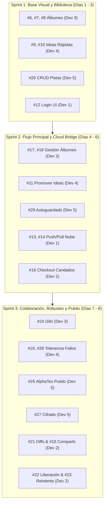

# Estimaciones de Issues y Plan de Tareas por Desarrollador

Análisis y reestructuración de las [issues abiertas](https://github.com/Chinano9/kizuna-editor/issues) del repositorio tras la implementación de las **5 fases de modernización y arquitectura del Backend** (modelos de dominio, infraestructura SQLite con WAL y migraciones, repositorios, servicios, audio engine y servidor Kizuna Cloud con OpenAPI).

---

## 🚀 Estado Actual de la Infraestructura Técnica

A diferencia del estado inicial del proyecto, los 5 desarrolladores ya **no tienen que construir la base técnica desde cero ni modificar archivos monolíticos**:

1. **Modelos de Dominio Desacoplados (`shared/models/`):** Modelos [`Song`](file:///home/raulaniles/Documentos/proyecos/kizuna-editor/shared/models/song.go), [`Track`](file:///home/raulaniles/Documentos/proyecos/kizuna-editor/shared/models/track.go), [`Album`](file:///home/raulaniles/Documentos/proyecos/kizuna-editor/shared/models/album.go), [`Instrument`](file:///home/raulaniles/Documentos/proyecos/kizuna-editor/shared/models/instrument.go) y [`AudioVersion`](file:///home/raulaniles/Documentos/proyecos/kizuna-editor/shared/models/audio_version.go) con constructores y validaciones.
2. **Infraestructura de Base de Datos y Migraciones (`client/internal/database/`):** Conexión SQLite con modo **WAL**, `busy_timeout = 5000` (previene bloqueos en concurrencia), `foreign_keys = ON` (`ON DELETE CASCADE` activo), migraciones versionadas y sembrado idempotente.
3. **Capa de Repositorios y Servicios (`client/internal/repository/`, `client/internal/service/`):** Lógica CRUD y transaccional completa para canciones, pistas, álbumes y tomas de audio.
4. **Motor de Audio Seguro (`client/internal/audio/`):** Captura y reproducción nativa sin bloqueos mutuos, codificación/decodificación WAV, selector de drivers y dispositivos.
5. **Kizuna Cloud API (`server/`):** Servidor HTTP con autenticación JWT, hash seguro de contraseñas, gestor de candados/checkouts colaborativos (`ProjectLocker`), motor de sincronización (`SyncEngine`), pruebas de integración y contratos documentados en [openapi.yaml](file:///home/raulaniles/Documentos/proyecos/kizuna-editor/server/docs/openapi.yaml).

---

## 📊 Tabla Comparativa de Estimaciones Reajustadas

Las estimaciones de esfuerzo se han reducido significativamente (de un promedio de 14.5 días por desarrollador a ~7.5 días) ya que el backend está listo y solo resta la capa visual, integración de eventos y lógica específica de cliente.

*Valores en días hábiles (1 desarrollador por tarea):*

| Issue | Título | Backend Listo | Tareas Restantes (Frontend / UI / Glue) | Óptimo | Probable | Pesimista | Asignado |
|---|---|---|---|---|---|---|---|
| **#6** | Creación de un álbum vacío | `AlbumService.CreateAlbum`, `AlbumHandler.CreateAlbum` | Modal en frontend para nombre/artista y botón "Nuevo Álbum" | 0.25 d | 0.5 d | 1 d | **Dev 3** |
| **#7** | Asignar un proyecto a un álbum | `AlbumService.AssignSongToAlbum` | Selector/dropdown de álbum en la vista del editor o dashboard | 0.25 d | 0.5 d | 1 d | **Dev 3** |
| **#8** | Explorar álbumes | `AlbumService.ListAlbums`, `GetAlbumSongs` | Vista de cuadrícula de álbumes y listado de canciones dentro de un álbum | 0.5 d | 1 d | 2 d | **Dev 3** |
| **#17** | Quitar de álbum | `AlbumService.RemoveSongFromAlbum` | Botón contextual "Desvincular del álbum" en UI | 0.25 d | 0.5 d | 1 d | **Dev 3** |
| **#18** | Editar álbum | `AlbumService.UpdateAlbum` | Modal/formulario para editar título, artista y descripción | 0.25 d | 0.5 d | 1 d | **Dev 3** |
| **#24** | Internacionalización (i18n) | Modelos y respuestas en UTF-8 | Archivos de traducción JSON (es/en) y store de idioma en Svelte | 0.5 d | 1.5 d | 3 d | **Dev 3** |
| **#9** | Grabación rápida | `AudioRecorder`, `AudioHandler.Start/Stop` | Botón de acceso rápido flotante o barra rápida en Dashboard | 0.5 d | 1 d | 2 d | **Dev 4** |
| **#10** | Bandeja de ideas | `SongService.SaveQuickIdea`, `AudioVersion` global | Vista tipo feed/inbox de memos de voz y notas rápidas | 0.5 d | 1.5 d | 2.5 d | **Dev 4** |
| **#11** | Transformar idea en proyecto | Lógica de tracks y guardado en `SongService` | Botón de promoción "Convertir en Canción" con modal de título/tempo | 0.5 d | 1 d | 2 d | **Dev 4** |
| **#19** | Eliminar idea rápida | `SongService.DeleteSong` / `AudioService.Delete` | Diálogo de confirmación visual y borrado de archivo físico de audio | 0.25 d | 0.5 d | 1 d | **Dev 4** |
| **#28** | Tolerancia a fallos en grabación | SQLite WAL + buffers protegidos contra corte de energía | Detección de tomas huérfanas al inicio de la app y modal de recuperación | 0.5 d | 1.5 d | 3 d | **Dev 4** |
| **#25** | Editor con renderizado AlphaTex | Bindings `SaveSong`, `GetSong`, `Track` model | Refactorización de `ScoreViewer` y debounce al escribir | 1 d | 2 d | 4 d | **Dev 5** |
| **#26** | Gestión central (CRUD) de Pistas | `TrackService`, `TrackHandler`, `instRepo` | Pestañas de pistas, silenciar (mute), selección de instrumento | 0.5 d | 1.5 d | 2.5 d | **Dev 5** |
| **#27** | Cifrado Zero-Knowledge | Modelos y payloads extensibles | Derivación PBKDF2/AES-GCM en cliente antes del push | 1 d | 2.5 d | 5 d | **Dev 5** |
| **#29** | Autoguardado silencioso del editor | Soporte concurrente WAL (no bloquea UI) | Timer con debounce (ej. 3s sin teclear) y badge visual "Guardado" | 0.25 d | 0.5 d | 1 d | **Dev 5** |
| **#12** | Inicio de sesión | Endpoints `/api/v1/auth/*`, JWT tokens | Modal de Login/Registro en cliente y almacenamiento de token | 0.5 d | 1.5 d | 3 d | **Dev 1** |
| **#13** | Subir a la nube | Endpoint `/api/v1/sync/push` | Cliente HTTP en desktop para subir payload JSON del proyecto | 0.5 d | 1.5 d | 3 d | **Dev 1** |
| **#14** | Consumir de la nube | Endpoint `/api/v1/sync/pull` | Botón "Descargar de la nube" e importación a SQLite local | 0.5 d | 1.5 d | 3 d | **Dev 1** |
| **#20** | Ciclo de sesión | Validación JWT con expiración en `/auth/me` | Refresh token silencioso y cierre de sesión en cliente | 0.25 d | 0.5 d | 1 d | **Dev 1** |
| **#15** | Compartir proyecto | `CloudProject.OwnerID` + consulta de usuario | Modal para ingresar email del colaborador y permiso de lectura/escritura | 0.5 d | 1 d | 2 d | **Dev 2** |
| **#16** | Check-out de proyecto | Endpoint `/api/v1/projects/{id}/checkout` | Indicador visual de candado/bloqueo en frontend al abrir proyecto | 0.5 d | 1 d | 2 d | **Dev 2** |
| **#21** | Visualización de cambios | Endpoint `/api/v1/sync/diff` | Comparador visual (diff) entre versión local y remota antes de sincronizar | 0.5 d | 1.5 d | 3 d | **Dev 2** |
| **#22** | Liberación de candado | Endpoint `/api/v1/projects/{id}/release` | Botón "Liberar candado" al cerrar o timeout automático | 0.25 d | 0.5 d | 1 d | **Dev 2** |
| **#23** | Reintento y carga de contenido | Manejo de conflictos 409 y estados de error | Notificación de fallo con botón "Reintentar sincronización" | 0.5 d | 1 d | 2 d | **Dev 2** |

---

## 👥 Resumen de Carga por Desarrollador (Reajuste a la Baja)

| Desarrollador | Área de Especialidad | Issues Asignadas | Carga Anterior | **Carga Actualizada** | Ahorro de Tiempo |
|---|---|---|---|---|---|
| **Dev 1** | Nube Base & Sesiones | #12, #13, #14, #20 | 14.5 días | **5.0 días** | **-65%** |
| **Dev 2** | Colaboración & Sincronización UX | #15, #16, #21, #22, #23 | 15.0 días | **5.0 días** | **-66%** |
| **Dev 3** | Biblioteca, Álbumes e i18n | #6, #7, #8, #17, #18, #24 | 12.5 días | **4.5 días** | **-64%** |
| **Dev 4** | Grabación, Audio e Ideas | #9, #10, #11, #19, #28 | 14.0 días | **5.5 días** | **-60%** |
| **Dev 5** | Editor, Partituras y Autoguardado | #25, #26, #27, #29 | 14.5 días | **7.0 días** | **-52%** |

---

## 🛠️ Plan Detallado de Tareas por Desarrollador

### 👤 Dev 1: Nube Base y Sesiones (#12, #13, #14, #20)
* **Objetivo:** Conectar el frontend de la app de escritorio con el servidor Kizuna Cloud para autenticación y sincronización básica.
* **Herramientas listas en Backend:**
  * Endpoints en `server/`: `/api/v1/auth/register`, `/api/v1/auth/login`, `/api/v1/auth/me`, `/api/v1/sync/push`, `/api/v1/sync/pull`.
  * Contrato OpenAPI en [openapi.yaml](file:///home/raulaniles/Documentos/proyecos/kizuna-editor/server/docs/openapi.yaml).
* **Tareas a Ejecutar:**
  1. Crear `src/features/cloud-sync/stores/authStore.ts` en el cliente para guardar el token JWT en `localStorage`.
  2. Implementar `AuthModal.svelte` con pestañas de "Iniciar Sesión" y "Crear Cuenta" (**#12**).
  3. Crear un cliente HTTP (`apiClient.ts`) con interceptor que añada automáticamente el header `Authorization: Bearer <token>` (**#20**).
  4. Implementar el botón "Subir a la nube" en la barra de herramientas del proyecto, consumiendo `/api/v1/sync/push` (**#13**).
  5. Implementar el botón "Importar de la nube" en la biblioteca del dashboard, consumiendo `/api/v1/sync/pull` (**#14**).

---

### 👤 Dev 2: Colaboración y UX de Nube (#15, #16, #21, #22, #23)
* **Objetivo:** Implementar la experiencia de usuario colaborativa, gestión de candados de edición y resolución de conflictos.
* **Herramientas listas en Backend:**
  * Endpoints en `server/`: `/api/v1/projects/{id}/checkout`, `/api/v1/projects/{id}/release`, `/api/v1/sync/diff`.
  * Motor de candados con expiración automática en [`Locker`](file:///home/raulaniles/Documentos/proyecos/kizuna-editor/server/internal/collaboration/locker.go).
* **Tareas a Ejecutar:**
  1. Integrar el checkout automático al abrir un proyecto de la nube: si está bloqueado por otro músico, mostrar badge "Modo Solo Lectura (Editado por [Nombre])" (**#16**).
  2. Implementar el botón "Liberar Edición" o liberar el candado al volver al Dashboard (`onDestroy`) (**#22**).
  3. Crear modal de compartir proyecto por correo electrónico (**#15**).
  4. Al detectar conflicto de versión (`409 Conflict`), consumir `/api/v1/sync/diff` y mostrar un modal comparativo con las diferencias antes de sobreescribir (**#21**).
  5. Crear componente de banner/toast de reintento automático con backoff exponencial ante fallos de conexión (**#23**).

---

### 👤 Dev 3: Biblioteca, Álbumes e Internacionalización (#6, #7, #8, #17, #18, #24)
* **Objetivo:** Desarrollar la interfaz visual de colecciones/álbumes y soporte multiidioma.
* **Herramientas listas en Backend:**
  * Métodos en Wails: `CreateAlbum`, `GetAlbum`, `ListAlbums`, `UpdateAlbum`, `DeleteAlbum`, `AssignSongToAlbum`, `RemoveSongFromAlbum`, `GetAlbumSongs`.
* **Tareas a Ejecutar:**
  1. Crear la vista `AlbumGrid.svelte` y tarjeta `AlbumCard.svelte` bajo `src/features/albums/` (**#8**).
  2. Crear modal `CreateAlbumModal.svelte` para ingresar título, artista y descripción (**#6**).
  3. Añadir botón "Editar Álbum" y "Eliminar Álbum" en la vista de detalle (**#18**).
  4. Agregar selector dropdown en los ajustes de canción para asignarla a un álbum o desvincularla (**#7**, **#17**).
  5. Configurar store de internacionalización con archivos de recursos `es.json` y `en.json`, permitiendo cambiar el idioma desde Ajustes (**#24**).

---

### 👤 Dev 4: Grabación Rápida, Audio y Bandeja de Ideas (#9, #10, #11, #19, #28)
* **Objetivo:** Refactorizar la barra de audio y crear la bandeja de captura espontánea de ideas.
* **Herramientas listas en Backend:**
  * Métodos en Wails: `StartRecording`, `StopRecording`, `GetAudioLevels`, `PlayAudio`, `PauseAudio`, `SeekAudio`, `SaveQuickIdea`.
  * Motor SQLite con modo WAL (previene bloqueos y pérdida de datos ante caídas).
* **Tareas a Ejecutar:**
  1. Implementar botón flotante o atajo de teclado para "Grabación Rápida" inmediata desde cualquier pantalla (**#9**).
  2. Crear la vista "Bandeja de Ideas" en el sidebar del Dashboard para reproducir memos de voz sin abrir el editor completo (**#10**).
  3. Implementar botón "Promover a Proyecto" que toma el archivo de audio de la idea y genera un proyecto formal con pista de voz/guitarra (**#11**).
  4. Añadir acción de eliminar idea con borrado físico del archivo `.wav` (**#19**).
  5. En el arranque de la app, escanear el directorio de audio temporal en busca de grabaciones incompletas o no registradas por caídas del sistema y ofrecer recuperarlas (**#28**).

---

### 👤 Dev 5: Editor, Pistas, Cifrado y Autoguardado (#25, #26, #27, #29)
* **Objetivo:** Perfeccionar la experiencia de escritura musical, gestión de pistas y autoguardado sin latencia.
* **Herramientas listas en Backend:**
  * Métodos en Wails: `SaveSong`, `AddTrack`, `DeleteTrack`, `UpdateTrack`, `GetInstruments`.
  * Conexión multi-hilo en SQLite optimizada para escrituras de fondo concurrentes.
* **Tareas a Ejecutar:**
  1. Implementar autoguardado silencioso en `Editor.svelte` con un debounce de 3 segundos tras dejar de escribir, mostrando un indicador sutil "✓ Guardado" en lugar del intrusivo `alert()` (**#29**).
  2. Mejorar la reactividad entre el editor de texto AlphaTex y el visor `ScoreViewer.svelte` evitando re-renderizados innecesarios (**#25**).
  3. Enriquecer `TrackTabs.svelte` permitiendo renombrar pistas, cambiar el instrumento asociado (Guitarra, Bajo, Batería, Piano, Voz) y silenciar pistas con `is_muted` (**#26**).
  4. Implementar cifrado en cliente con AES-GCM (usando `crypto.subtle`) para cifrar el contenido de las letras y AlphaTex antes de ser sincronizado a la nube (**#27**).

---

## 🚦 Orden Sugerido de Ejecución

