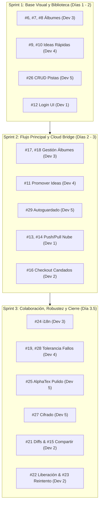

# Estimaciones de Issues y Plan de Tareas por Desarrollador

Análisis y reestructuración integral de las [issues abiertas](https://github.com/Chinano9/kizuna-editor/issues) del repositorio tras la culminación de la **modernización de arquitectura del Backend (Fases 1–5)** y del **Frontend (Fases 1–5)**.

---

## 🚀 Estado Actual de la Infraestructura Técnica

Los 5 desarrolladores ya **no tienen que construir código base desde cero ni modificar archivos monolíticos**; cada integrante cuenta con módulos aislados, contratos claros y herramientas de UI y estado listas para conectar:

### ⚙️ Backend (Go / SQLite / Kizuna Cloud / Wails Bindings)
1. **Modelos de Dominio Desacoplados (`shared/models/`):** Modelos [`Song`](file:///home/raulaniles/Documentos/proyecos/kizuna-editor/shared/models/song.go), [`Track`](file:///home/raulaniles/Documentos/proyecos/kizuna-editor/shared/models/track.go), [`Album`](file:///home/raulaniles/Documentos/proyecos/kizuna-editor/shared/models/album.go), [`Instrument`](file:///home/raulaniles/Documentos/proyecos/kizuna-editor/shared/models/instrument.go) y [`AudioVersion`](file:///home/raulaniles/Documentos/proyecos/kizuna-editor/shared/models/audio_version.go) con constructores y validaciones.
2. **Infraestructura de Base de Datos y Migraciones (`client/internal/database/`):** Conexión SQLite con modo **WAL**, `busy_timeout = 5000` (previene bloqueos en concurrencia), `foreign_keys = ON` (`ON DELETE CASCADE` activo), migraciones versionadas y sembrado idempotente.
3. **Capa de Repositorios y Servicios (`client/internal/repository/`, `client/internal/service/`):** Lógica CRUD y transaccional completa para canciones, pistas, álbumes y tomas de audio.
4. **Motor de Audio Seguro (`client/internal/audio/`):** Captura y reproducción nativa sin bloqueos mutuos, codificación/decodificación WAV, selector de drivers y dispositivos.
5. **Kizuna Cloud API (`server/`):** Servidor HTTP con autenticación JWT, hash seguro de contraseñas, gestor de candados/checkouts colaborativos (`ProjectLocker`), motor de sincronización (`SyncEngine`), pruebas de integración y contratos documentados en [openapi.yaml](file:///home/raulaniles/Documentos/proyecos/kizuna-editor/server/docs/openapi.yaml).

### 🎨 Frontend (Svelte / TypeScript / Feature-Sliced Architecture)
1. **Tipado Estricto y Adaptadores Wails (`src/shared/types/`):** Adaptador centralizado [`wails.ts`](file:///home/raulaniles/Documentos/proyecos/kizuna-editor/client/frontend/src/shared/types/wails.ts) con tipado sincronizado, alias limpios (`@app`, `@shared`, `@features`, `@wails`), cero errores en `svelte-check`.
2. **Arquitectura Modular por Funcionalidades (`src/features/`):** Carpetas aisladas por dominio (`dashboard/`, `albums/`, `editor/`, `score-viewer/`, `track-management/`, `audio-deck/`, `cloud-sync/`) para evitar colisiones de Git entre los 5 desarrolladores.
3. **UI Kit Primitives (`src/shared/components/ui/`):** Componentes accesibles con estética LCD Studio: [`Button.svelte`](file:///home/raulaniles/Documentos/proyecos/kizuna-editor/client/frontend/src/shared/components/ui/Button.svelte), [`Modal.svelte`](file:///home/raulaniles/Documentos/proyecos/kizuna-editor/client/frontend/src/shared/components/ui/Modal.svelte), [`Select.svelte`](file:///home/raulaniles/Documentos/proyecos/kizuna-editor/client/frontend/src/shared/components/ui/Select.svelte), [`Slider.svelte`](file:///home/raulaniles/Documentos/proyecos/kizuna-editor/client/frontend/src/shared/components/ui/Slider.svelte), [`Toggle.svelte`](file:///home/raulaniles/Documentos/proyecos/kizuna-editor/client/frontend/src/shared/components/ui/Toggle.svelte).
4. **Descomposición del Audio Deck (`src/features/audio-deck/components/`):** Desacoplado en [`HardwareDeck.svelte`](file:///home/raulaniles/Documentos/proyecos/kizuna-editor/client/frontend/src/features/audio-deck/components/HardwareDeck.svelte), [`SessionTimeDisplay.svelte`](file:///home/raulaniles/Documentos/proyecos/kizuna-editor/client/frontend/src/features/audio-deck/components/SessionTimeDisplay.svelte), [`TransportControls.svelte`](file:///home/raulaniles/Documentos/proyecos/kizuna-editor/client/frontend/src/features/audio-deck/components/TransportControls.svelte), [`VuEqualizer.svelte`](file:///home/raulaniles/Documentos/proyecos/kizuna-editor/client/frontend/src/features/audio-deck/components/VuEqualizer.svelte), [`TakesManager.svelte`](file:///home/raulaniles/Documentos/proyecos/kizuna-editor/client/frontend/src/features/audio-deck/components/TakesManager.svelte), [`VolumeSlider.svelte`](file:///home/raulaniles/Documentos/proyecos/kizuna-editor/client/frontend/src/features/audio-deck/components/VolumeSlider.svelte) y [`TimelineRail.svelte`](file:///home/raulaniles/Documentos/proyecos/kizuna-editor/client/frontend/src/features/audio-deck/components/TimelineRail.svelte). 0 advertencias de accesibilidad (A11y).
5. **Sistema de Notificaciones Toast (`src/shared/components/feedback/`):** Eliminación total de llamadas bloqueantes `alert()`, reemplazadas por [`toastStore`](file:///home/raulaniles/Documentos/proyecos/kizuna-editor/client/frontend/src/shared/stores/toastStore.ts) (`success`, `error`, `warning`, `info`) con montaje global en [`App.svelte`](file:///home/raulaniles/Documentos/proyecos/kizuna-editor/client/frontend/src/app/App.svelte).
6. **Stores Transaccionales e Inmutables:** [`activeSongStore.ts`](file:///home/raulaniles/Documentos/proyecos/kizuna-editor/client/frontend/src/features/editor/stores/activeSongStore.ts) con métodos transaccionales inmutables (`setTitle`, `addTrack`, `updateTrack`, `removeTrack`) y protección de límites en [`trackStore.ts`](file:///home/raulaniles/Documentos/proyecos/kizuna-editor/client/frontend/src/stores/trackStore.ts) (`clamp`).
7. **Suite de Pruebas Unitarias Frontend:** Pruebas nativas automatizadas en [`tests/`](file:///home/raulaniles/Documentos/proyecos/kizuna-editor/client/frontend/tests/) ejecutables mediante `npm test` para formateadores, parsing rítmico de AlphaTex y ciclo de toasts.

---

## 📊 Tabla Comparativa de Estimaciones Actualizadas

Al contar con backend completo, UI Kit reutilizable y stores inmutables, la carga de trabajo restante se enfoca exclusivamente en la interacción de interfaz y cableado de eventos:

*Valores en días hábiles (1 desarrollador por tarea):*

| Issue | Título | Backend Listo | Herramientas Frontend Listas | Tareas Restantes de Implementación | Estimación Inicial | **Estimación Actual** | Asignado |
|---|---|---|---|---|---|---|---|
| **#6** | Creación de un álbum vacío | `AlbumService.CreateAlbum`, `AlbumHandler.CreateAlbum` | `Modal.svelte`, `Button.svelte`, `albumStore.ts` | Formulario con inputs en modal y llamada a store | 1.5 d | **0.25 d** | **Dev 3** |
| **#7** | Asignar un proyecto a un álbum | `AlbumService.AssignSongToAlbum` | `Select.svelte`, `albumStore.ts` | Dropdown de álbum en panel de canción | 1.5 d | **0.25 d** | **Dev 3** |
| **#8** | Explorar álbumes | `AlbumService.ListAlbums`, `GetAlbumSongs` | `src/features/albums/`, `Button.svelte` | Cuadrícula visual de álbumes y listado | 2.0 d | **0.5 d** | **Dev 3** |
| **#17** | Quitar de álbum | `AlbumService.RemoveSongFromAlbum` | `Button.svelte` (variant danger/ghost), `toastStore` | Botón contextual "Desvincular" en vista de álbum | 2.0 d | **0.25 d** | **Dev 3** |
| **#18** | Editar álbum | `AlbumService.UpdateAlbum` | `Modal.svelte`, `albumStore.updateAlbum` | Formulario para editar nombre y descripción | 2.5 d | **0.25 d** | **Dev 3** |
| **#24** | Internacionalización (i18n) | Modelos y respuestas en UTF-8 | `src/shared/stores/` | Diccionarios JSON (es/en) y dropdown en ajustes | 3.0 d | **1.0 d** | **Dev 3** |
| **#9** | Grabación rápida | `AudioRecorder`, `AudioHandler.Start/Stop` | `TransportControls.svelte`, `audioRecorderStore` | Botón de acceso rápido en Dashboard o atajo global | 3.0 d | **0.5 d** | **Dev 4** |
| **#10** | Bandeja de ideas | `SongService.SaveQuickIdea`, `AudioVersion` global | `TakesManager.svelte`, `audioPlayerStore` | Vista tipo feed en sidebar para memos de voz | 2.5 d | **1.0 d** | **Dev 4** |
| **#11** | Transformar idea en proyecto | `SongService` lógica transaccional | `Modal.svelte`, `Button.svelte`, `activeSongStore` | Botón "Convertir a Canción" con modal de tempo/título | 3.0 d | **0.5 d** | **Dev 4** |
| **#19** | Eliminar idea rápida | `SongService.DeleteSong` / `AudioService.Delete` | `Modal.svelte` confirmación, `toastStore` | Diálogo visual y borrado físico de audio | 1.5 d | **0.25 d** | **Dev 4** |
| **#28** | Tolerancia a fallos en grabación | SQLite WAL + buffers protegidos contra cortes | `toastStore.warning`, modal de recuperación | Chequeo de tomas huérfanas en inicio y restauración | 4.0 d | **1.0 d** | **Dev 4** |
| **#25** | Editor con renderizado AlphaTex | Bindings `SaveSong`, `GetSong`, `Track` model | `ScoreViewer.svelte`, `LyricsViewer.svelte`, `musicUtils` | Rescaling responsive y debounce en escritura | 5.0 d | **1.0 d** | **Dev 5** |
| **#26** | Gestión central (CRUD) de Pistas | `TrackService`, `TrackHandler`, `instRepo` | `TrackTabs.svelte`, `activeSongStore`, `trackStore.clamp` | Botón de mute, cambio de instrumento y añadir pista | 3.0 d | **0.5 d** | **Dev 5** |
| **#27** | Cifrado Zero-Knowledge | Modelos y payloads extensibles | `src/features/cloud-sync/` | Derivación PBKDF2/AES-GCM en Web Crypto API | 5.0 d | **2.0 d** | **Dev 5** |
| **#29** | Autoguardado silencioso del editor | Soporte concurrente WAL (no bloquea UI) | `toastStore.success`, debounce timer en `activeSongStore` | Timer de 3s sin teclear y notificación sutil | 1.5 d | **0.25 d** | **Dev 5** |
| **#12** | Inicio de sesión | Endpoints `/api/v1/auth/*`, JWT tokens | `Modal.svelte`, `Button.svelte`, `syncStore.ts` | Formulario de Login/Registro y guardado de token | 5.0 d | **1.0 d** | **Dev 1** |
| **#13** | Subir a la nube | Endpoint `/api/v1/sync/push` | `Button.svelte`, `toastStore`, `syncStore` | Cliente HTTP para enviar payload del proyecto | 4.0 d | **1.0 d** | **Dev 1** |
| **#14** | Consumir de la nube | Endpoint `/api/v1/sync/pull` | `Button.svelte`, `toastStore`, `recentSongsStore` | Botón de descarga e importación a base local | 4.0 d | **1.0 d** | **Dev 1** |
| **#20** | Ciclo de sesión | Validación JWT con expiración en `/auth/me` | `syncStore.clearAuth()`, `toastStore` | Refresh de token silencioso y cierre de sesión | 1.5 d | **0.25 d** | **Dev 1** |
| **#15** | Compartir proyecto | `CloudProject.OwnerID` + consulta de usuario | `Modal.svelte`, `Button.svelte`, `toastStore` | Modal para ingresar email del colaborador | 3.0 d | **0.5 d** | **Dev 2** |
| **#16** | Check-out de proyecto | Endpoint `/api/v1/projects/{id}/checkout` | `syncStore.setLock()`, badge visual LCD | Indicador de candado en tiempo real al abrir proyecto | 3.0 d | **0.5 d** | **Dev 2** |
| **#21** | Visualización de cambios | Endpoint `/api/v1/sync/diff` | `Modal.svelte` con comparación en dos columnas | Modal de diferencias locales vs remotas en conflicto | 3.0 d | **1.0 d** | **Dev 2** |
| **#22** | Liberación de candado | Endpoint `/api/v1/projects/{id}/release` | `Button.svelte`, evento `onDestroy` en editor | Liberación explícita o al regresar a biblioteca | 2.0 d | **0.25 d** | **Dev 2** |
| **#23** | Reintento y carga de contenido | Manejo de conflictos 409 y estados de error | `toastStore.error` con acción o botón "Reintentar" | Estrategia de reintento automático ante fallos de red | 4.0 d | **0.5 d** | **Dev 2** |

---

## 👥 Resumen de Carga por Desarrollador (Ahorro Acumulado)

| Desarrollador | Área de Especialidad | Issues Asignadas | Carga Inicial Monolito | Carga Post-Backend | **Carga Definitiva (Backend + Frontend Listos)** | **Ahorro Total** |
|---|---|---|---|---|---|---|
| **Dev 1** | Nube Base & Sesiones | #12, #13, #14, #20 | 14.5 días | 5.0 días | **3.25 días** | **-78%** |
| **Dev 2** | Colaboración & UX Nube | #15, #16, #21, #22, #23 | 15.0 días | 5.0 días | **2.75 días** | **-82%** |
| **Dev 3** | Biblioteca, Álbumes e i18n | #6, #7, #8, #17, #18, #24 | 12.5 días | 4.5 días | **2.50 días** | **-80%** |
| **Dev 4** | Grabación, Audio e Ideas | #9, #10, #11, #19, #28 | 14.0 días | 5.5 días | **3.25 días** | **-77%** |
| **Dev 5** | Editor, Partituras y Autoguardado | #25, #26, #27, #29 | 14.5 días | 7.0 días | **3.75 días** | **-74%** |
| **TOTAL** | **Equipo de 5 Desarrolladores** | **23 Issues Abiertas** | **70.5 días** | **27.0 días** | **15.5 días** | **-78%** |

---

## 🛠️ Guía Práctica de Trabajo por Desarrollador

### 👤 Dev 1: Nube Base y Sesiones (#12, #13, #14, #20)
* **Carpeta Exclusiva:** `src/features/cloud-sync/`
* **Herramientas a Utilizar:**
  * Endpoints HTTP en Go: `/api/v1/auth/*` y `/api/v1/sync/*` (documentados en `server/docs/openapi.yaml`).
  * Store de sesión: [`src/features/cloud-sync/stores/syncStore.ts`](file:///home/raulaniles/Documentos/proyecos/kizuna-editor/client/frontend/src/features/cloud-sync/stores/syncStore.ts).
  * UI: [`Modal.svelte`](file:///home/raulaniles/Documentos/proyecos/kizuna-editor/client/frontend/src/shared/components/ui/Modal.svelte), [`Button.svelte`](file:///home/raulaniles/Documentos/proyecos/kizuna-editor/client/frontend/src/shared/components/ui/Button.svelte) y [`toastStore`](file:///home/raulaniles/Documentos/proyecos/kizuna-editor/client/frontend/src/shared/stores/toastStore.ts).
* **Pasos:**
  1. Crear `AuthModal.svelte` dentro de `src/features/cloud-sync/components/` invocando `syncStore.setAuth(email, token)`.
  2. Implementar botones en Dashboard ("Subir a la nube" / "Bajar de la nube") invocando los endpoints REST `/api/v1/sync/push` y `/api/v1/sync/pull`.

---

### 👤 Dev 2: Colaboración y UX de Nube (#15, #16, #21, #22, #23)
* **Carpeta Exclusiva:** `src/features/cloud-sync/components/`
* **Herramientas a Utilizar:**
  * Endpoints HTTP en Go: `/api/v1/projects/{id}/checkout`, `/release`, `/diff`.
  * Store: `syncStore.isLockedByOther`, `syncStore.lockedBy`.
  * UI: `Modal.svelte` para el comparador de diffs y `toastStore.warning`/`error` para reintentos.
* **Pasos:**
  1. Conectar la comprobación de candado al abrir una canción remota en el editor.
  2. En caso de conflicto de versión (`409 Conflict`), consumir `/api/v1/sync/diff` y mostrar el modal comparativo antes de sincronizar.

---

### 👤 Dev 3: Biblioteca, Álbumes e Internacionalización (#6, #7, #8, #17, #18, #24)
* **Carpeta Exclusiva:** `src/features/albums/`
* **Herramientas a Utilizar:**
  * Bindings de Wails: `AlbumHandler` (`CreateAlbum`, `GetAlbum`, `ListAlbums`, `UpdateAlbum`, `DeleteAlbum`, `AssignSongToAlbum`, `RemoveSongFromAlbum`).
  * Store: [`src/features/albums/stores/albumStore.ts`](file:///home/raulaniles/Documentos/proyecos/kizuna-editor/client/frontend/src/features/albums/stores/albumStore.ts).
  * UI: `Modal.svelte`, `Select.svelte`, `Button.svelte`.
* **Pasos:**
  1. Implementar `AlbumGrid.svelte` y `AlbumCard.svelte` usando `albumStore`.
  2. Usar `Modal.svelte` para crear y editar álbumes (#6, #18).
  3. Vincular `Select.svelte` en los ajustes de canción para asociar/quitar de un álbum (#7, #17).
  4. Agregar archivo de traducción `es.json` y `en.json` con store de idioma (#24).

---

### 👤 Dev 4: Grabación Rápida, Audio y Bandeja de Ideas (#9, #10, #11, #19, #28)
* **Carpeta Exclusiva:** `src/features/audio-deck/`
* **Herramientas a Utilizar:**
  * Bindings de Wails: `StartRecording`, `StopRecording`, `SaveQuickIdea`, `PlayAudio`.
  * Stores: [`audioRecorderStore`](file:///home/raulaniles/Documentos/proyecos/kizuna-editor/client/frontend/src/features/audio-deck/stores/audioRecorderStore.ts), [`audioPlayerStore`](file:///home/raulaniles/Documentos/proyecos/kizuna-editor/client/frontend/src/features/audio-deck/stores/audioPlayerStore.ts).
  * Componentes ya desacoplados: [`TransportControls.svelte`](file:///home/raulaniles/Documentos/proyecos/kizuna-editor/client/frontend/src/features/audio-deck/components/TransportControls.svelte), [`TakesManager.svelte`](file:///home/raulaniles/Documentos/proyecos/kizuna-editor/client/frontend/src/features/audio-deck/components/TakesManager.svelte).
* **Pasos:**
  1. Conectar botón de "Grabación Rápida" (#9) consumiendo `StartRecording(0, "Quick Idea", devID)`.
  2. Implementar la vista "Bandeja de Ideas" (#10) listando tomas globales de SQLite.
  3. Botón "Promover a Proyecto" (#11) convirtiendo el memo en una canción con una pista formal.
  4. Detección de grabaciones incompletas al iniciar la aplicación (#28).

---

### 👤 Dev 5: Editor, Pistas, Cifrado y Autoguardado (#25, #26, #27, #29)
* **Carpetas Exclusivas:** `src/features/editor/`, `src/features/score-viewer/`, `src/features/track-management/`
* **Herramientas a Utilizar:**
  * Bindings de Wails: `SaveSong`, `AddTrack`, `DeleteTrack`, `UpdateTrack`.
  * Stores: [`activeSongStore`](file:///home/raulaniles/Documentos/proyecos/kizuna-editor/client/frontend/src/features/editor/stores/activeSongStore.ts) con métodos inmutables y [`trackStore.clamp()`](file:///home/raulaniles/Documentos/proyecos/kizuna-editor/client/frontend/src/stores/trackStore.ts).
  * Feedback: [`toastStore.success()`](file:///home/raulaniles/Documentos/proyecos/kizuna-editor/client/frontend/src/shared/stores/toastStore.ts).
* **Pasos:**
  1. Configurar un temporizador con debounce de 3 segundos en `Editor.svelte` que invoque `SaveSong` y muestre `toastStore.success("✓ Guardado silencioso")` (#29).
  2. Optimizar reactividad entre AlphaTex y `ScoreViewer.svelte` (#25).
  3. Conectar botón de silenciar pista (`is_muted`) en `TrackTabs.svelte` (#26).
  4. Implementar derivación de claves con PBKDF2 y cifrado de payload con AES-GCM antes de la sincronización remota (#27).

---

## 🚦 Orden de Sprints Sugerido

