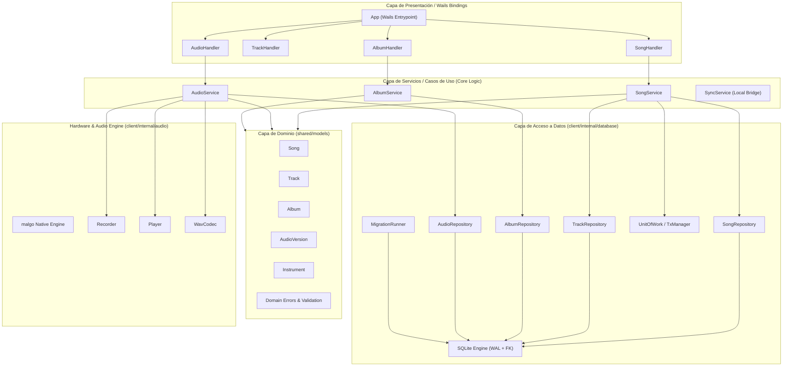
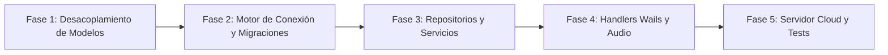

# 🛠️ Plan Integral de Mejora de Arquitectura e Ingeniería — Backend (Go / Wails / SQLite)

**Proyecto:** Kizuna Editor  
**Versión del Plan:** 1.0  
**Enfoque:** Arquitectura Limpia, Robustez Local-First, Alta Concurrencia y Trabajo en Equipo (5 Desarrolladores)  
**Fecha de Elaboración:** Octubre 2026  

---

## 📋 1. Resumen Ejecutivo y Diagnóstico del Estado Actual

Tras realizar un análisis exhaustivo del código fuente en los módulos `client/`, `shared/` y `server/`, se han identificado importantes deudas técnicas y cuellos de botella arquitectónicos que dificultan la escalabilidad del software y generan un alto riesgo de conflictos de integración (*merge conflicts*) para un equipo de 5 desarrolladores trabajando en paralelo (Issues #6 a #29).

### 🔍 Hallazgos Críticos Identificados

1. **Monolito de Modelos (`shared/models/entities.go`):**
   - Todos los structs principales de dominio (`Album`, `Song`, `Instrument`, `Track`, `AudioVersion`) residen en un único archivo de 57 líneas.
   - Carecen de métodos de validación (`Validate()`), constructores (`NewSong()`), métodos de dominio y control de tipos nulos.
   - Cada vez que los desarrolladores añadan metadatos (e.g. estado de sincronización en nube para Dev 1/2, campos de álbumes para Dev 3, metadatos de audio para Dev 4 o cifrado para Dev 5), chocarán en este mismo archivo.

2. **Monolito en Persistencia (`client/db.go` - 729 líneas):**
   - **Alta cohesión perdida y violación de Responsabilidad Única (SRP):** El struct `DBManager` asume la resolución de rutas por Sistema Operativo (`getDefaultDBPath`), conexión con el motor `sqlite`, creación del schema en crudo (`createFullSchema`), ejecución de semillas (`seedInstruments`), migraciones improvisadas y todas las consultas SQL de todas las entidades.
   - **Migraciones inseguras:** Se ejecuta `ALTER TABLE audio_versions ADD COLUMN track_id...` ignorando el error con `_, _ = db.Exec(...)`. Este mecanismo no escala para soportar los cambios de esquema que exigen las nuevas issues (bloqueos de sincronización, cifrado, versiones, tags).
   - **Riesgo crítico de bloqueos en SQLite (`database is locked` / `SQLITE_BUSY`):** No hay activación de modo WAL (`PRAGMA journal_mode = WAL;`), no se establece `PRAGMA busy_timeout`, ni se limita el pool de conexiones de escritura (`SetMaxOpenConns`). Al grabar audio en segundo plano mientras el frontend consulta o autoguarda tracks, la base de datos se bloqueará.
   - **Integridad referencial comprometida:** En SQLite, las claves foráneas están deshabilitadas por defecto. Al no ejecutar `PRAGMA foreign_keys = ON;`, las restricciones `ON DELETE CASCADE` definidas en el DDL no se están aplicando en tiempo de ejecución.
   - **Manejo de errores fatal:** `NewDBManager` utiliza `log.Fatal`, cerrando abruptamente la aplicación de escritorio si el archivo no puede abrirse, en lugar de retornar errores controlados al ciclo de arranque.

3. **`client/app.go` como "God Object" (378 líneas):**
   - `App` expone directamente a Wails métodos de acceso a datos, control de dispositivos de hardware de audio, manipulación de sistema de archivos y sanitización de rutas.
   - No existe una capa intermedia de Servicios (*Use Cases / Business Logic*). Todo el equipo añadirá bindings de Wails al mismo archivo `app.go`.

4. **Subsistema de Audio (`client/recorder/`):**
   - Utiliza variables globales de paquete (`sharedCtx`, `currentDriverName`, `sharedCtxMu`).
   - El ciclo de vida de captura y reproducción está acoplado a CGO/malgo sin interfaces que permitan pruebas unitarias con mocks.

5. **Estado de Kizuna Cloud (`server/`):**
   - Es actualmente un directorio vacío (`go.mod`). No hay contratos de API, estructura base ni interfaces para la sincronización y autenticación requeridas por las issues #12–#16 y #20–#23.

---

## 🏛️ 2. Arquitectura Objetivo Propuesta

Se propone una **Arquitectura en Capas Limpia (Clean Layered Architecture)** adaptada al ecosistema de escritorio con Wails y monorepo Go:



---

## 📁 3. Nueva Estructura del Backend

### 3.1. Reorganización de `shared/models/` (Modelos de Dominio por Archivo)

Se desmantela `shared/models/entities.go` y se crean archivos independientes con validaciones explícitas, constructores y métodos de dominio:

```
shared/
├── go.mod
└── models/
    ├── album.go          # Struct Album, validaciones, AlbumFilter
    ├── audio_version.go  # Struct AudioVersion, tipos de Take, AudioMetadata
    ├── errors.go         # Errores estándar de dominio (ErrNotFound, ErrValidation)
    ├── instrument.go     # Struct Instrument, constantes de catálogo
    ├── song.go           # Struct Song, constructor NewSong(), validaciones de tempo/compás
    ├── track.go          # Struct Track, modos de visualización (TAB, NOTATION, BOTH)
    └── validation.go     # Helpers reutilizables de validación (títulos, rangos)
```

#### Ejemplo de Implementación: `shared/models/song.go`
```go
package models

import (
	"errors"
	"strings"
	"time"
)

var (
	ErrEmptyTitle       = errors.New("el título de la canción no puede estar vacío")
	ErrInvalidBPM       = errors.New("el BPM debe estar comprendido entre 20 y 320")
	ErrInvalidSignature = errors.New("métrica de compás inválida (formato esperado: N/D)")
)

type Song struct {
	ID            int       `db:"id" json:"id"`
	AlbumID       *int      `db:"album_id" json:"album_id,omitempty"`
	Title         string    `db:"title" json:"title"`
	BPM           int       `db:"bpm" json:"bpm"`
	TimeSignature string    `db:"time_signature" json:"time_signature"`
	KeySignature  string    `db:"key_signature" json:"key_signature"`
	CreatedAt     time.Time `db:"created_at" json:"created_at"`
	UpdatedAt     time.Time `db:"updated_at" json:"updated_at"`

	Tracks []Track `db:"-" json:"tracks,omitempty"`
}

func NewSong(title string, bpm int, timeSignature string) (*Song, error) {
	s := &Song{
		Title:         strings.TrimSpace(title),
		BPM:           bpm,
		TimeSignature: timeSignature,
		CreatedAt:     time.Now().UTC(),
		UpdatedAt:     time.Now().UTC(),
		Tracks:        make([]Track, 0),
	}
	if err := s.Validate(); err != nil {
		return nil, err
	}
	return s, nil
}

func (s *Song) Validate() error {
	if strings.TrimSpace(s.Title) == "" {
		return ErrEmptyTitle
	}
	if s.BPM < 20 || s.BPM > 320 {
		return ErrInvalidBPM
	}
	if s.TimeSignature == "" {
		s.TimeSignature = "4/4"
	}
	return nil
}
```

---

### 3.2. Reorganización de `client/` (Desacoplamiento de `db.go` y `app.go`)

Se reestructura `client/` para aislar bases de datos, repositorios, servicios y bindings de Wails:

```
client/
├── go.mod
├── go.sum
├── main.go                       # Punto de entrada Wails, inyección de dependencias
├── app.go                        # Fachada principal de Wails (bindings limpios y reducidos)
├── bindings/                     # Handlers divididos por dominio (evita conflictos git)
│   ├── album_handler.go          # Métodos Wails para álbumes (Dev 3)
│   ├── audio_handler.go          # Métodos Wails para grabación/reproducción (Dev 4)
│   ├── song_handler.go           # Métodos Wails para canciones (Dev 5)
│   └── track_handler.go          # Métodos Wails para pistas (Dev 5)
├── internal/
│   ├── database/
│   │   ├── connection.go         # Apertura SQLite, pragmas (WAL, FK, timeout), pooling
│   │   ├── paths.go              # Detección de rutas OS (Windows, macOS, Linux XDG)
│   │   ├── seeder.go             # Inserción idempotente de instrumentos iniciales
│   │   ├── migrator/
│   │   │   ├── migrator.go       # Motor transaccional de migraciones con schema_migrations
│   │   │   └── sql/              # Archivos SQL versionados (.up.sql)
│   │   │       ├── 000001_initial_schema.up.sql
│   │   │       ├── 000002_add_track_id_to_audio_versions.up.sql
│   │   │       └── 000003_create_sync_and_locks.up.sql
│   │   └── transaction.go        # Abstracción UnitOfWork / TxRunner
│   ├── repository/
│   │   ├── album_repository.go
│   │   ├── audio_repository.go
│   │   ├── instrument_repository.go
│   │   ├── song_repository.go
│   │   └── track_repository.go
│   ├── service/
│   │   ├── album_service.go
│   │   ├── audio_service.go      # Orquestación entre audio físico y base de datos
│   │   ├── song_service.go       # Reglas de negocio de canciones y guardado rápido
│   │   └── track_service.go      # Reglas de pistas y validación AlphaTex
│   └── audio/                    # Reubicación y modernización de client/recorder/
│       ├── context.go            # Manejador seguro del contexto de malgo
│       ├── device.go             # Enumeración y cambio dinámico de dispositivos
│       ├── player.go             # Reproductor PCM / WAV sin race conditions
│       ├── recorder.go           # Grabador de audio con buffer circular thread-safe
│       └── wav.go                # Codificador/decodificador WAV optimizado
└── wails.json
```

---

## 🔧 4. Rediseño Detallado de Persistencia y Base de Datos

### 4.1. Configuración Robusta de SQLite (`connection.go`)

Para evitar bloqueos y fallos de integridad referencial:

```go
package database

import (
	"database/sql"
	"fmt"
	"time"

	_ "modernc.org/sqlite"
)

type Config struct {
	Path        string
	BusyTimeout time.Duration
}

func Open(cfg Config) (*sql.DB, error) {
	// DSN optimizado con PRAGMAs indispensables para aplicaciones de escritorio multi-hilo
	dsn := fmt.Sprintf("%s?_pragma=busy_timeout(%d)&_pragma=journal_mode(WAL)&_pragma=foreign_keys(ON)&_pragma=synchronous(NORMAL)",
		cfg.Path,
		cfg.BusyTimeout.Milliseconds(),
	)

	db, err := sql.Open("sqlite", dsn)
	if err != nil {
		return nil, fmt.Errorf("error al abrir conexión SQLite: %w", err)
	}

	// SQLite en modo WAL maneja perfectamente múltiples lectores concurrentes,
	// pero solo un escritor simultáneo. Configuramos el pool para prevenir contención:
	db.SetMaxOpenConns(10)
	db.SetMaxIdleConns(5)
	db.SetConnMaxLifetime(time.Hour)

	if err := db.Ping(); err != nil {
		db.Close()
		return nil, fmt.Errorf("ping a la base de datos falló: %w", err)
	}

	return db, nil
}
```

### 4.2. Sistema de Migraciones Versionadas (`migrator.go`)

En lugar del frágil `ALTER TABLE` ignorado, se implementa una tabla de control `schema_migrations`:

```sql
CREATE TABLE IF NOT EXISTS schema_migrations (
    version INTEGER PRIMARY KEY,
    applied_at DATETIME DEFAULT CURRENT_TIMESTAMP
);
```

Las migraciones se almacenan como archivos `.sql` embebidos vía `//go:embed sql/*.sql`. El `Migrator` aplica únicamente las versiones pendientes dentro de transacciones individuales atómicas.

### 4.3. Patrón Repositorio y Transacciones

Para permitir que los desarrolladores trabajen de forma aislada y creen pruebas con mocks:

```go
package repository

import (
	"context"
	"database/sql"
	"kizuna/shared/models"
)

type SongRepository interface {
	GetByID(ctx context.Context, id int) (*models.Song, error)
	GetRecent(ctx context.Context, limit int) ([]models.Song, error)
	Create(ctx context.Context, tx *sql.Tx, song *models.Song) (int64, error)
	Update(ctx context.Context, tx *sql.Tx, song *models.Song) error
	Delete(ctx context.Context, tx *sql.Tx, id int) error
}
```

---

## ☁️ 5. Arquitectura del Backend Kizuna Cloud (`server/`)

Para desbloquear las issues #12–#16, #20–#23 y #27 (Dev 1 y Dev 2), se establece la estructura base del servidor API:

```
server/
├── go.mod
├── go.sum
├── cmd/
│   └── api/
│       └── main.go               # Inicialización del servidor HTTP (Go 1.22+ stdlib o Gin)
├── internal/
│   ├── auth/                     # Autenticación JWT y hash de contraseñas (Issue #12, #20)
│   │   ├── jwt.go
│   │   └── service.go
│   ├── collaboration/            # Bloqueo de proyectos y check-out (Issue #16, #22)
│   │   └── locker.go
│   ├── handlers/                 # Controladores HTTP REST
│   │   ├── auth_handler.go
│   │   ├── project_handler.go
│   │   └── sync_handler.go
│   ├── storage/                  # Persistencia en nube (PostgreSQL o SQLite remoto + MinIO/S3 para WAVs)
│   └── sync/                     # Motor de sincronización diferencial (Issue #13, #14, #21)
│       └── engine.go
└── pkg/
    └── response/                 # Formato uniforme de respuestas JSON y errores
```

---

## 👥 6. Matriz de Asignación y Trabajo en Equipo (5 Desarrolladores)

| Rol / Desarrollador | Módulos Asignados en Backend | Archivos Clave a Crear / Modificar | Issues Directas |
|---|---|---|---|
| **Dev 1** *(Nube Base)* | `server/internal/auth`, `server/internal/sync` | `server/cmd/api/main.go`, `server/internal/auth/*` | #12, #13, #14, #20 |
| **Dev 2** *(Colaboración Nube)* | `server/internal/collaboration`, endpoints de lock | `server/internal/collaboration/*`, `server/internal/handlers/sync_handler.go` | #15, #16, #21, #22, #23 |
| **Dev 3** *(Biblioteca)* | `shared/models/album.go`, `client/internal/repository/album_repository.go` | `client/internal/service/album_service.go`, `client/bindings/album_handler.go` | #6, #7, #8, #17, #18, #24 |
| **Dev 4** *(Audio & Ideas)* | `shared/models/audio_version.go`, `client/internal/audio/*` | `client/internal/service/audio_service.go`, `client/bindings/audio_handler.go` | #9, #10, #11, #19, #28 |
| **Dev 5** *(Editor & Tracks)* | `shared/models/track.go`, `shared/models/song.go` | `client/internal/repository/song_repository.go`, `client/internal/service/track_service.go` | #25, #26, #27, #29 |

> [!IMPORTANT]
> **Regla de Oro para Evitar Conflictos Git:**  
> Ningún desarrollador debe editar directamente `app.go` o `connection.go`. Cada desarrollador trabajará en su propio `repository`, `service` y `handler` independiente dentro de `client/bindings/`.

---

## 🚀 7. Plan de Ejecución Paso a Paso



### Fase 1: Separación de Modelos de Dominio (Día 1 - 2)
1. Dividir `shared/models/entities.go` en `album.go`, `song.go`, `track.go`, `instrument.go`, `audio_version.go` y `errors.go`.
2. Añadir métodos `.Validate()` y constructores para cada entidad.
3. Ejecutar `go test ./...` y verificar compilación en `client/` y `shared/`.

### Fase 2: Infraestructura de Base de Datos y Migraciones (Día 2 - 4)
1. Crear `client/internal/database/connection.go` con PRAGMAs obligatorias (`foreign_keys=ON`, `journal_mode=WAL`, `busy_timeout=5000`).
2. Implementar `client/internal/database/paths.go` para resolución limpia de directorios.
3. Crear sistema de migraciones versionadas en `client/internal/database/migrator/` con scripts SQL embebidos.
4. Mover el seed de instrumentos a `seeder.go` con verificación `INSERT OR IGNORE`.

### Fase 3: Capa de Repositorios y Servicios (Día 5 - 7)
1. Implementar interfaces e implementaciones para `SongRepository`, `TrackRepository`, `AlbumRepository` y `AudioRepository`.
2. Crear `SongService`, `TrackService` y `AlbumService` abstrayendo la lógica de negocio de `db.go`.
3. Validar con pruebas unitarias usando SQLite en memoria (`:memory:`).

### Fase 4: Desacoplamiento de Wails y Audio Engine (Día 8 - 10)
1. Migrar la lógica de `client/recorder/` a `client/internal/audio/`, resolviendo la concurrencia con mutexes dedicados y contexto malgo seguro.
2. Dividir `client/app.go` en handlers modulares bajo `client/bindings/`.
3. Conectar la inyección de dependencias en `client/main.go`.

### Fase 5: Estructura del Servidor Cloud y Suite de Pruebas (Día 11 - 13)
1. Crear el esqueleto en `server/cmd/api/main.go` con autenticación JWT básica y contratos de sincronización.
2. Añadir pruebas de integración para el guardado de canciones y tomas de audio.
3. Documentar contratos en formato OpenAPI/Swagger.
