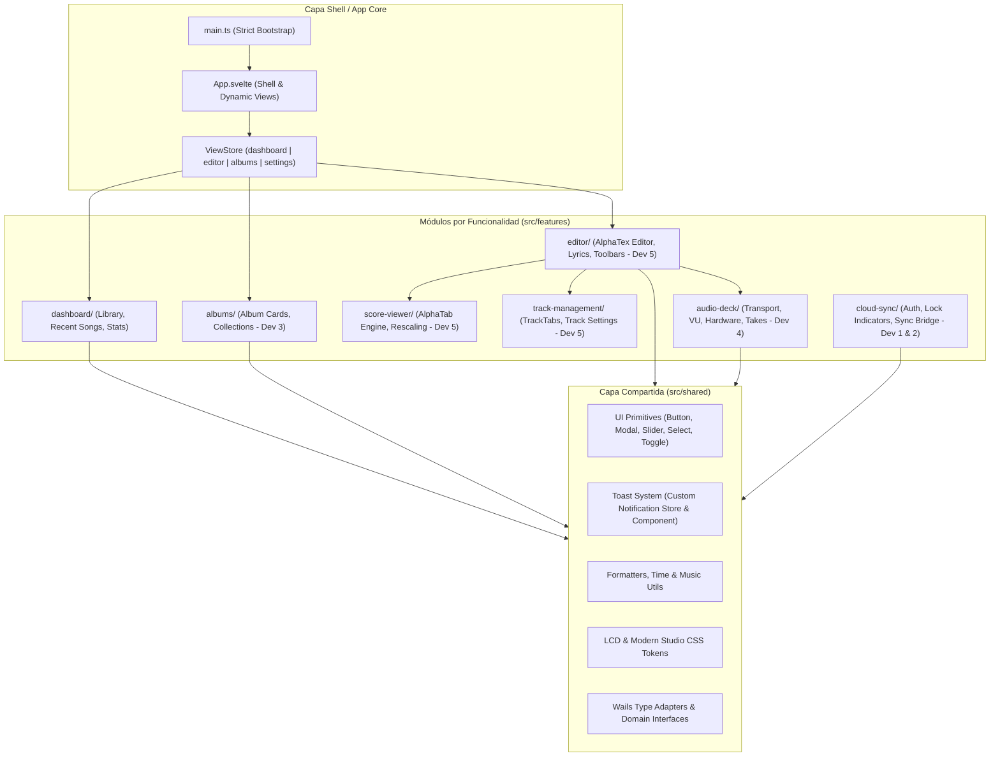
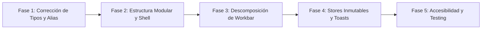

# 🎨 Plan Integral de Mejora de Arquitectura e Ingeniería — Frontend (Svelte / TypeScript / Wails)

**Proyecto:** Kizuna Editor  
**Versión del Plan:** 1.0  
**Enfoque:** Arquitectura Modular por Funcionalidades (Feature-Sliced), Tipado Estricto, Descomposición de Monolitos y Trabajo en Equipo (5 Desarrolladores)  
**Fecha de Elaboración:** Octubre 2026  

---

## 📋 1. Resumen Ejecutivo y Diagnóstico del Estado Actual

El frontend de Kizuna Editor está construido con **Svelte 3 + TypeScript + Vite 3**, integrándose con el backend de Go mediante los bindings generados automáticamente por Wails. 

Al ejecutar un chequeo diagnóstico exhaustivo con `svelte-check` y revisar la estructura del código, se detectaron deficiencias técnicas críticas que rompen la verificación de tipos, perjudican la experiencia de usuario y generarán bloqueos constantes en un equipo de 5 desarrolladores trabajando simultáneamente en las issues #6 a #29.

### 🔍 Hallazgos Críticos Identificados

1. **`svelte-check` Fallando con 9 Errores de Tipado TypeScript:**
   - **Espacios de nombres erróneos en modelos generados por Wails:** En `wailsjs/go/models.ts`, Wails exporta `namespace models` y `namespace recorder`. Sin embargo, en múltiples componentes y stores (`instrumentStore.ts`, `EditorLayout.svelte`, `TrackTabs.svelte`, `Workbar.svelte`, `ScoreViewer.svelte`, `Editor.svelte`) se intenta importar `import type { main } from "../../wailsjs/go/models"`, lo cual arroja el error: `Module has no exported member 'main'`.
   - **Rutas de importación relativas rotas:** En `projectStore.ts`, `Editor.svelte` y `ScoreViewer.svelte` se importan tipos usando `../../../wailsjs/go/models` (tres niveles hacia atrás en lugar de dos o usando el alias configurado), provocando fallos de resolución de módulos.
   - **Incompatibilidad de tipos en `LyricsViewer.svelte`:** Se invoca `marked(source)` y se asigna directamente a `renderedHtml: string`. En versiones modernas de `marked`, la función puede retornar `string | Promise<string>`, causando el error de tipado en TypeScript.
   - **Inseguridad de tipos en `main.js`:** El punto de entrada sigue siendo JavaScript en lugar de TypeScript y pasa `document.getElementById('app')` sin comprobación de nulidad.

2. **Monolito Inmantenible en `Workbar.svelte` (1,143 líneas):**
   - Este componente concentra de forma acoplada:
     - Máquina de estados de grabación de audio (timers, niveles VU, animación de 12 barras de ecualizador).
     - Selección de hardware de entrada y driver del sistema (WASAPI, ALSA, CoreAudio).
     - Reproductor de audio (play, pause, seek, volumen, progreso sincronizado).
     - Selector y gestión de tomas (*takes*) y versiones de audio por pista o globales.
     - Más de **600 líneas de reglas CSS** duplicadas y sin aislar.
   - Cualquier cambio por parte de Dev 4 (grabación y tolerancia a fallos) o Dev 2 (reproducción en colaboración) provocará conflictos de Git irresolubles.

3. **Estructura Plana de Carpetas Propensa a Colisiones:**
   - Todo se agrupa en `src/components/`, `src/stores/` y `src/layouts/`.
   - Cinco desarrolladores trabajando en diferentes épicas (Álbumes para Dev 3, Grabación para Dev 4, Editor para Dev 5, Sincronización para Dev 1/2) editarán los mismos directorios y archivos compartidos (`Dashboard.svelte`, `EditorLayout.svelte`, `projectStore.ts`).

4. **Inconsistencias y Desincronización en la Gestión de Estado (Stores):**
   - En `projectStore.ts` existen simultáneamente el store `songTitle = writable<string>("My New Idea")` y el objeto `song = writable<main.Song | null>(null)`. Modificar el título en uno no sincroniza reactivamente el otro.
   - En `TrackTabs.svelte`, se muta directamente la propiedad interna del store: `$song.tracks = [...currentTracks, newTrack]; song.set($song);` en lugar de utilizar métodos de mutación inmutables encapsulados en el store.
   - El índice activo (`activeTrackIndex`) no valida si se eliminan pistas, pudiendo provocar desbordamientos de array (*out-of-bounds*).

5. **Experiencia de Usuario Deficiente y Código Muerto:**
   - **Uso de `alert()` del navegador:** Para avisar del guardado exitoso o fallos se utiliza `alert()`, lo cual pausa el hilo principal, bloquea la ventana nativa y degrada la calidad de la aplicación de escritorio.
   - **Conflicto de hojas de estilo globales:** Existen `src/style.css` (con estilos de la plantilla base de Wails, fuentes Nunito y fondo genérico) y `src/styles/main.css` junto con `src/styles/lcd-theme.css`. Ambos definen estilos contradictorios para `body` y `:root`.
   - **Advertencias de Accesibilidad (A11y):** Los `<label>` de los selectores en `Workbar.svelte` no están asociados a sus controles correspondientes mediante `for` o envoltorio.

---

## 🏛️ 2. Arquitectura Objetivo Propuesta

Se propone una **Arquitectura Modular Orientada a Funcionalidades (Feature-Sliced Architecture)**:



---

## 📁 3. Nueva Estructura del Frontend

### 3.1. Árbol de Directorios Modular

```
client/frontend/src/
├── app/
│   ├── App.svelte                # Shell principal de la aplicación
│   ├── main.ts                   # Entrada TypeScript (migrado desde main.js)
│   └── routes.ts                 # Definición de vistas (dashboard, editor, albums)
│
├── assets/
│   ├── fonts/                    # Bravura, Nunito, VT323
│   └── images/                   # Logotipos e íconos SVG
│
├── shared/                       # Componentes, utilidades y tokens reusables
│   ├── components/
│   │   ├── ui/
│   │   │   ├── Button.svelte
│   │   │   ├── Modal.svelte
│   │   │   ├── Select.svelte
│   │   │   ├── Slider.svelte
│   │   │   └── Toggle.svelte
│   │   └── feedback/
│   │       ├── Toast.svelte      # Sistema visual de notificaciones (reemplaza alert)
│   │       └── ToastContainer.svelte
│   ├── lib/
│   │   ├── formatters.ts         # Formateo de tiempo (00:00.00), tamaños y fechas
│   │   └── musicUtils.ts         # Parseo de AlphaTex y cálculo de compases
│   ├── stores/
│   │   ├── toastStore.ts         # Notificaciones no bloqueantes
│   │   └── viewStore.ts          # Navegación entre vistas
│   ├── styles/
│   │   ├── reset.css             # Reseteo CSS limpio sin colisiones
│   │   ├── lcd-tokens.css        # Variables de diseño (verde fosforescente, ámbar, bordes)
│   │   ├── typography.css        # Declaración de fuentes Bravura y Nunito
│   │   └── global.css            # Punto de entrada de estilos unificados
│   └── types/
│       ├── index.ts              # Exportación centralizada de interfaces
│       └── wails.ts              # Adaptadores de tipos de Wails (models.Song, etc.)
│
└── features/                     # Dominios aislados para cada desarrollador
    │
    ├── dashboard/                # Vistas principales de bienvenida y biblioteca
    │   ├── components/
    │   │   ├── DashboardHeader.svelte
    │   │   └── RecentSongCard.svelte
    │   ├── stores/
    │   │   └── recentSongsStore.ts
    │   └── index.ts
    │
    ├── albums/                   # Épica de Álbumes (Dev 3 - Issues #6, #7, #8, #17, #18)
    │   ├── components/
    │   │   ├── AlbumGrid.svelte
    │   │   ├── AlbumCard.svelte
    │   │   └── AssignAlbumModal.svelte
    │   ├── stores/
    │   │   └── albumStore.ts
    │   └── index.ts
    │
    ├── editor/                   # Editor de Texto y Partitura (Dev 5 - Issues #25, #29)
    │   ├── components/
    │   │   ├── EditorTextarea.svelte
    │   │   ├── EditorToolbar.svelte
    │   │   └── AutoBarToggle.svelte
    │   ├── stores/
    │   │   └── activeSongStore.ts  # Store transaccional e inmutable del proyecto
    │   └── index.ts
    │
    ├── score-viewer/             # Renderizado AlphaTab (Dev 5 - Issue #25)
    │   ├── components/
    │   │   ├── ScoreViewer.svelte
    │   │   └── LyricsViewer.svelte # Corregido tipado sincrónico de marked
    │   └── lib/
    │       └── alphatabController.ts
    │
    ├── track-management/         # Gestión de Pistas (Dev 5 - Issue #26)
    │   ├── components/
    │   │   ├── TrackTabs.svelte
    │   │   ├── TrackTabItem.svelte
    │   │   └── InstrumentSelector.svelte
    │   ├── stores/
    │   │   └── trackStore.ts
    │   └── index.ts
    │
    ├── audio-deck/               # Refactorización de Workbar.svelte (Dev 4 - #9, #10, #19, #28)
    │   ├── components/
    │   │   ├── Workbar.svelte           # Orquestador contenedor (< 100 líneas)
    │   │   ├── TransportControls.svelte # Play, Pause, Record, Stop
    │   │   ├── VuMeter.svelte           # Medición de decibelios / pico
    │   │   ├── EqualizerBars.svelte     # 12 barras animadas LCD
    │   │   ├── HardwareDeck.svelte      # Selección de Driver y Micrófono
    │   │   ├── TakesManager.svelte      # Selector de tomas por pista o global
    │   │   └── VolumeSlider.svelte      # Monitor fader con display
    │   ├── stores/
    │   │   ├── audioRecorderStore.ts
    │   │   └── audioPlayerStore.ts
    │   └── index.ts
    │
    └── cloud-sync/               # Sincronización en Nube (Dev 1 & 2 - Issues #12–#16, #20–#23)
        ├── components/
        │   ├── AuthModal.svelte
        │   ├── LockIndicator.svelte
        │   └── SyncStatusBadge.svelte
        ├── stores/
        │   └── syncStore.ts
        └── index.ts
```

---

## ⚙️ 4. Configuración de Alias y Resolución de Tipos

### 4.1. Actualización de `tsconfig.json`

Se definen alias limpios para evitar rutas relativas frágiles (`../../../`):

```json
{
  "extends": "@tsconfig/svelte/tsconfig.json",
  "compilerOptions": {
    "target": "ESNext",
    "useDefineForClassFields": true,
    "module": "ESNext",
    "resolveJsonModule": true,
    "allowJs": false,
    "checkJs": false,
    "isolatedModules": true,
    "baseUrl": ".",
    "paths": {
      "@app/*": ["src/app/*"],
      "@shared/*": ["src/shared/*"],
      "@features/*": ["src/features/*"],
      "@wails/*": ["wailsjs/*"]
    }
  },
  "include": [
    "src/**/*.d.ts",
    "src/**/*.ts",
    "src/**/*.svelte",
    "wailsjs/**/*.ts"
  ],
  "exclude": ["node_modules", "dist"]
}
```

### 4.2. Actualización de `vite.config.js`

```javascript
import { defineConfig } from "vite";
import { svelte } from "@sveltejs/vite-plugin-svelte";
import path from "path";

export default defineConfig({
  plugins: [svelte()],
  publicDir: "public",
  resolve: {
    alias: {
      "@app": path.resolve(__dirname, "src/app"),
      "@shared": path.resolve(__dirname, "src/shared"),
      "@features": path.resolve(__dirname, "src/features"),
      "@wails": path.resolve(__dirname, "wailsjs"),
    },
  },
  build: {
    target: "esnext",
    chunkSizeWarningLimit: 1200,
  },
});
```

### 4.3. Adaptador Central de Tipos de Wails (`src/shared/types/wails.ts`)

Para asegurar consistencia en todo el proyecto:

```typescript
import { models as WailsModels, recorder as WailsRecorder } from "@wails/go/models";

// Tipos de dominio principales exportados limpiamente
export type Song = WailsModels.Song;
export type Track = WailsModels.Track;
export type Instrument = WailsModels.Instrument;
export type AudioVersion = WailsModels.AudioVersion;
export type AudioDevice = WailsRecorder.AudioDevice;

// Constructores y fábricas auxiliares
export const SongModel = WailsModels.Song;
export const TrackModel = WailsModels.Track;
export const AudioVersionModel = WailsModels.AudioVersion;
```

---

## 🧩 5. Descomposición del Monolito `Workbar.svelte`

El archivo `Workbar.svelte` actual cuenta con **1,143 líneas**. Su refactorización divide la responsabilidad en 6 subcomponentes especializados:

```mermaid
flowchart TD
    W[Workbar Container] --> HD[HardwareDeck.svelte]
    W --> TC[TransportControls.svelte]
    W --> VU[VuMeter.svelte]
    W --> EQ[EqualizerBars.svelte]
    W --> TM[TakesManager.svelte]
    W --> VS[VolumeSlider.svelte]

    HD -.->|Driver & Device ID| ARS[audioRecorderStore]
    TC -.->|Start/Stop/Seek| ARS & APS[audioPlayerStore]
    VU -.->|Level [0.0 - 1.0]| ARS
    TM -.->|Take Selection| APS
    VS -.->|Gain Multiplier| APS
```

### Ejemplo: Orquestador `src/features/audio-deck/components/Workbar.svelte` (< 85 líneas)

```svelte
<script lang="ts">
    import HardwareDeck from "./HardwareDeck.svelte";
    import TransportControls from "./TransportControls.svelte";
    import VuMeter from "./VuMeter.svelte";
    import EqualizerBars from "./EqualizerBars.svelte";
    import TakesManager from "./TakesManager.svelte";
    import VolumeSlider from "./VolumeSlider.svelte";
    import type { Track } from "@shared/types/wails";

    export let songID: number;
    export let activeTrack: Track | null;
</script>

<footer class="deck-container" aria-label="Audio Deck & Transport">
    <div class="deck-panel deck-left">
        <HardwareDeck />
    </div>

    <div class="deck-panel deck-center">
        <TransportControls {songID} {activeTrack} />
        <div class="visualizer-strip">
            <VuMeter />
            <EqualizerBars />
        </div>
    </div>

    <div class="deck-panel deck-right">
        <TakesManager {songID} {activeTrack} />
        <VolumeSlider />
    </div>
</footer>

<style>
    .deck-container {
        display: grid;
        grid-template-columns: 280px 1fr 300px;
        height: 120px;
        background-color: var(--lcd-header-bg);
        border-top: 1px solid var(--lcd-border);
        box-shadow: 0 -4px 15px rgba(0, 0, 0, 0.4);
        padding: 8px 16px;
        gap: 16px;
    }
    .deck-panel {
        display: flex;
        flex-direction: column;
        justify-content: center;
    }
    .visualizer-strip {
        display: flex;
        align-items: center;
        gap: 12px;
        margin-top: 6px;
    }
</style>
```

---

## 🔔 6. Reemplazo de `alert()` por Sistema Central de Toasts

Se crea un store y componente de notificación para brindar retroalimentación no bloqueante y moderna con estética LCD / Studio:

### Store: `src/shared/stores/toastStore.ts`
```typescript
import { writable } from "svelte/store";

export type ToastType = "success" | "error" | "info" | "warning";

export interface ToastMessage {
    id: string;
    message: string;
    type: ToastType;
    durationMs?: number;
}

const { subscribe, update } = writable<ToastMessage[]>([]);

export const toastStore = {
    subscribe,
    show: (message: string, type: ToastType = "info", durationMs = 3500) => {
        const id = Math.random().toString(36).substring(2, 9);
        update((toasts) => [...toasts, { id, message, type, durationMs }]);
        setTimeout(() => {
            update((toasts) => toasts.filter((t) => t.id !== id));
        }, durationMs);
    },
    success: (msg: string) => toastStore.show(msg, "success"),
    error: (msg: string) => toastStore.show(msg, "error", 5000),
    warning: (msg: string) => toastStore.show(msg, "warning"),
    info: (msg: string) => toastStore.show(msg, "info"),
};
```

---

## 👥 7. Matriz de Asignación y Trabajo en Equipo (5 Desarrolladores)

| Desarrollador | Módulos Asignados en Frontend | Carpetas Exclusivas | Issues Asociadas |
|---|---|---|---|
| **Dev 1** *(Nube Base)* | Modal de Login, Ciclo de Sesión, Estados de Token | `src/features/cloud-sync/components/Auth*`, `src/features/cloud-sync/stores/auth*` | #12, #20 |
| **Dev 2** *(Colaboración Nube)* | Insignias de Bloqueo, Comparador de Versiones, Reintentos | `src/features/cloud-sync/components/Lock*`, `src/features/cloud-sync/components/Conflict*` | #15, #16, #21, #22, #23 |
| **Dev 3** *(Biblioteca & Álbumes)* | Vistas de Álbumes, Asignación de Canciones, i18n | `src/features/albums/*`, `src/features/dashboard/*` | #6, #7, #8, #17, #18, #24 |
| **Dev 4** *(Audio & Grabación)* | Refactorización de Audio Deck, Grabador Rápido, Bandeja de Ideas | `src/features/audio-deck/*` | #9, #10, #11, #19, #28 |
| **Dev 5** *(Editor & Partituras)* | Textarea de AlphaTex, Pistas, Autoguardado silencioso, Cifrado | `src/features/editor/*`, `src/features/score-viewer/*`, `src/features/track-management/*` | #25, #26, #27, #29 |

> [!TIP]
> **Aislamiento en Git:**  
> Gracias a la estructura `features/<nombre>`, cada desarrollador trabaja dentro de su carpeta aislada. El único punto de encuentro es `src/shared/`, el cual solo puede modificarse mediante Pull Requests con aprobación del equipo.

---

## 🚀 8. Plan de Ejecución Paso a Paso



### Fase 1: Corrección de Tipos y Errores de Compilación (Día 1)
1. Corregir todos los imports erróneos de `main.Track` a `models.Track` en los componentes actuales.
2. Corregir las rutas relativas `../../../wailsjs` reemplazándolas por `@wails`.
3. Resolver el error de `marked` en `LyricsViewer.svelte` usando `marked.parse(source, { async: false })` o tipado explícito.
4. Migrar `src/main.js` a `src/main.ts` con chequeo seguro de `document.getElementById('app')`.
5. Ejecutar `npx svelte-check` hasta obtener **0 errores**.

### Fase 2: Configuración de Rutas, Alias y Nueva Estructura (Día 2 - 3)
1. Actualizar `tsconfig.json` y `vite.config.js` con `@app`, `@shared`, `@features` y `@wails`.
2. Crear la jerarquía de directorios bajo `src/shared/` y `src/features/`.
3. Eliminar `src/style.css` y consolidar los tokens de diseño en `src/shared/styles/lcd-tokens.css` y `global.css`.

### Fase 3: Descomposición de Monolitos (`Workbar.svelte`) (Día 4 - 6)
1. Extraer los controles de transporte a `TransportControls.svelte`.
2. Extraer el medidor VU y las barras de ecualización a componentes dedicados.
3. Extraer la selección de drivers y hardware a `HardwareDeck.svelte`.
4. Dejar `Workbar.svelte` como un contenedor limpio de menos de 100 líneas.
5. Asignar etiquetas `<label for="...">` a cada control para eliminar las advertencias A11y.

### Fase 4: Reestructuración de Stores y Sistema de Toasts (Día 7 - 9)
1. Crear `toastStore.ts` y montar `ToastContainer.svelte` en `App.svelte`.
2. Reemplazar todas las llamadas `alert()` por `toastStore.success()` y `toastStore.error()`.
3. Unificar `songTitle` dentro de `activeSongStore.ts` garantizando inmutabilidad.
4. Implementar guardas para evitar índices fuera de rango en la eliminación de pistas.

### Fase 5: Pruebas Unitarias de Utilidades y Accesibilidad (Día 10 - 12)
1. Configurar Vitest para pruebas unitarias de `musicUtils.ts` (cálculo de compases y tuplet ratios) y formateadores.
2. Probar la aplicación en entorno de desarrollo Wails (`wails dev`) verificando compatibilidad multiplataforma.
3. Entregar documentación de onboarding al equipo de 5 desarrolladores.
